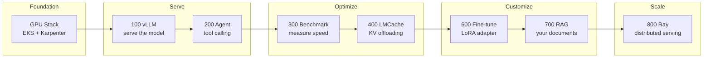
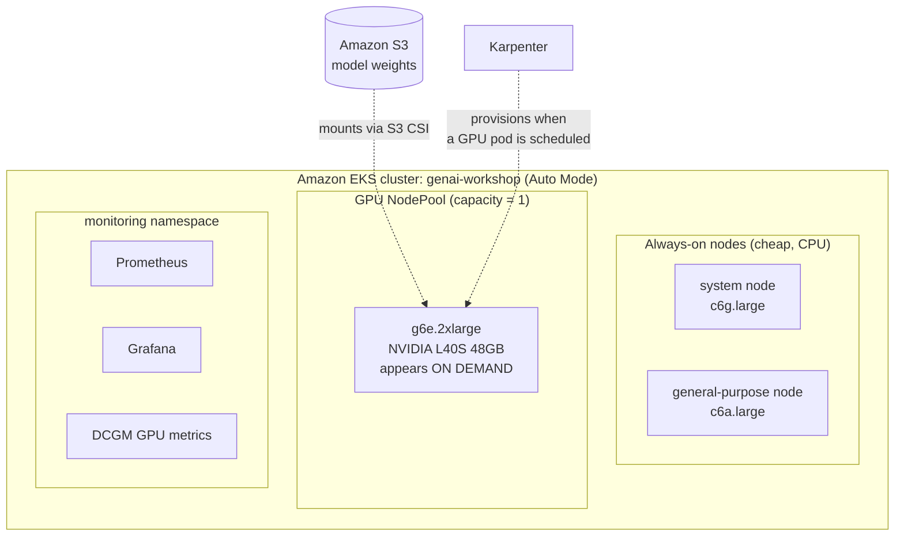
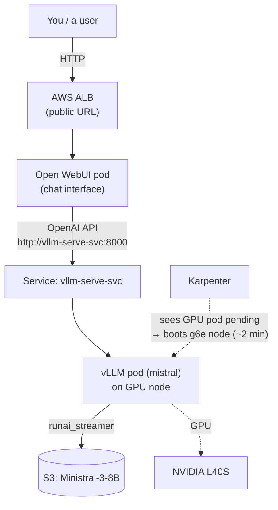
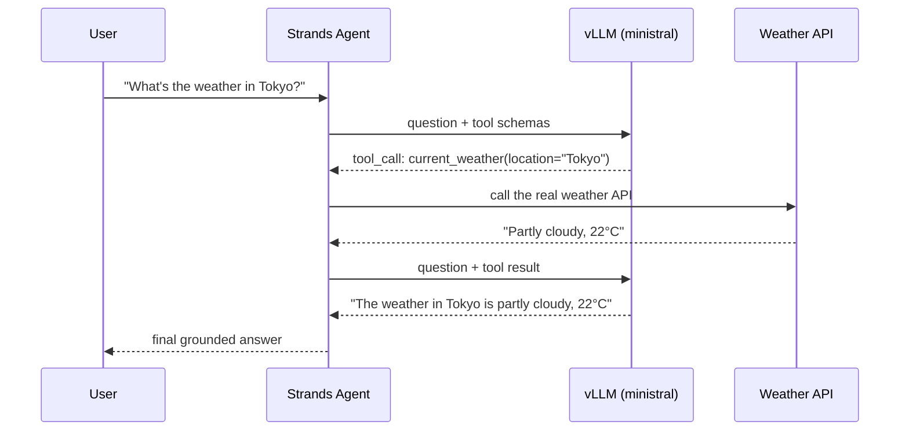
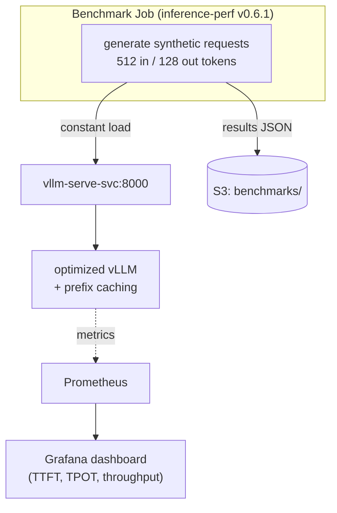
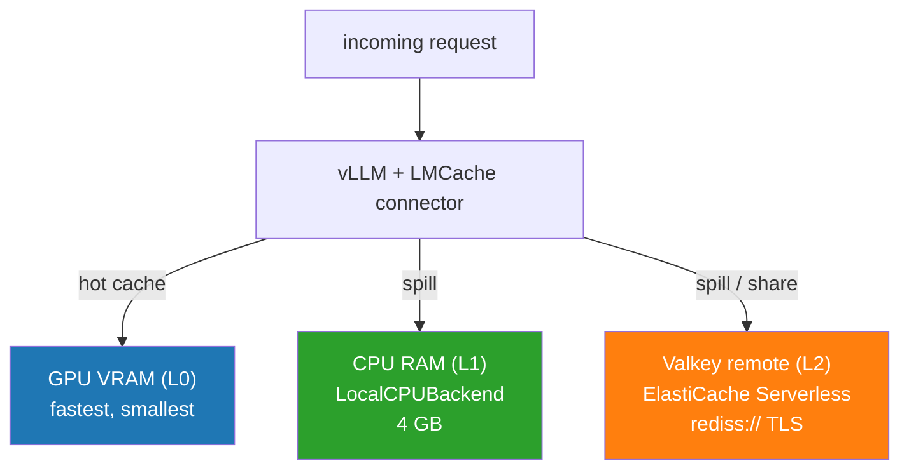
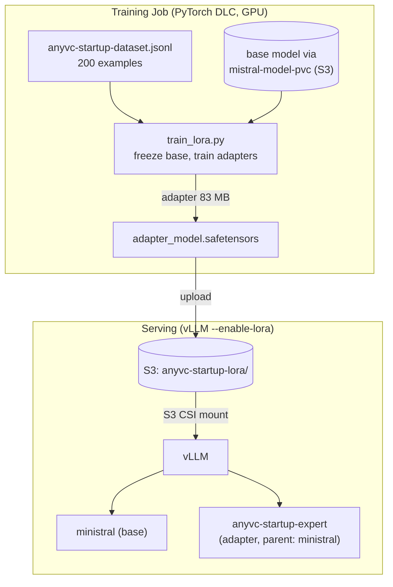
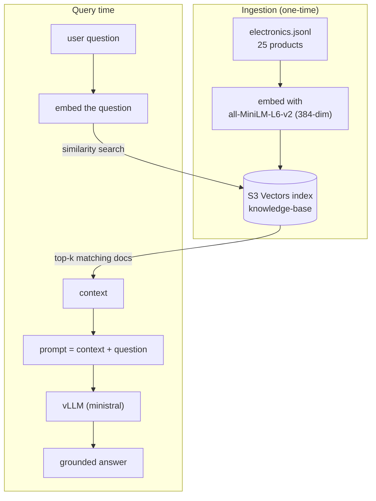
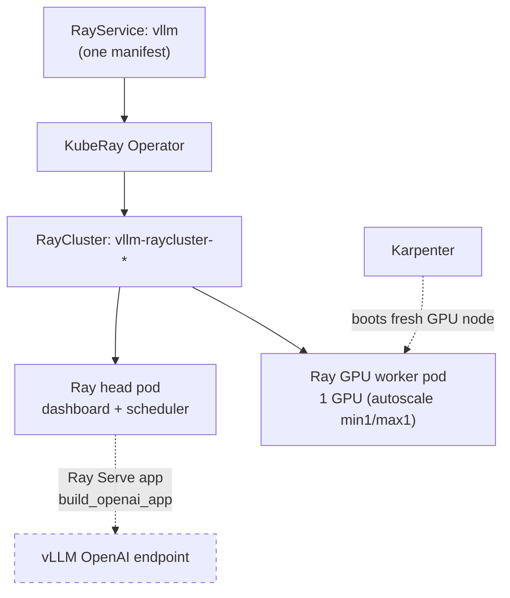
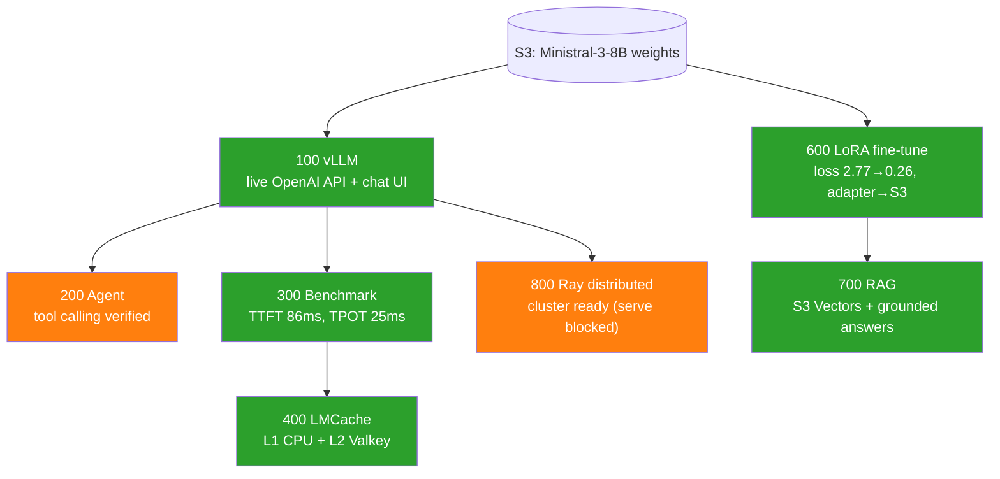

# Workshop Flow: Customizing LLMs on AWS EKS

> A beginner-to-advanced walkthrough of **what actually happens** when you run each module of this workshop on a real Amazon EKS cluster.
>
> Every diagram and result in this document comes from a **real execution** on the `genai-workshop` EKS cluster (account `215808926717`, region `us-east-2`, model **Ministral-3-8B-Instruct-2512**). Where something was blocked by the environment, it is called out honestly with the exact reason.

---

## Table of Contents

1. [How to read this document](#how-to-read-this-document)
2. [The big picture](#the-big-picture)
3. [The foundation: EKS Auto Mode + Karpenter + GPUs](#the-foundation)
4. [Module 100 — Serve an LLM with vLLM](#module-100--serve-an-llm-with-vllm)
5. [Module 200 — Turn the LLM into an Agent](#module-200--turn-the-llm-into-an-agent)
6. [Module 300 — Benchmark the LLM](#module-300--benchmark-the-llm)
7. [Module 400 — Offload the KV cache with LMCache](#module-400--offload-the-kv-cache-with-lmcache)
8. [Module 600 — Fine-tune with LoRA](#module-600--fine-tune-with-lora)
9. [Module 700 — Retrieval-Augmented Generation (RAG)](#module-700--retrieval-augmented-generation-rag)
10. [Module 800 — Distributed serving with Ray](#module-800--distributed-serving-with-ray)
11. [End-to-end flow of the whole workshop](#end-to-end-flow)
12. [Cheat sheet: every command used](#cheat-sheet)

---

## How to read this document

Each module section has the same shape so you always know where you are:

- **What it teaches** — the one idea in plain English.
- **How it flows** — a Mermaid diagram you can read top-to-bottom.
- **What really happened** — the actual result when executed on the cluster.
- **Commands** — the exact `kubectl` / `aws` commands.

> **New to the words "pod", "node", "cluster"?**
> - A **cluster** is a group of computers managed together (your EKS cluster).
> - A **node** is one computer (an EC2 instance) in that cluster.
> - A **pod** is the smallest unit you run — one or more containers that live on a node.
> - **Karpenter** is a robot that adds/removes nodes automatically when pods need them.

---

## The big picture

This workshop takes you from "a model sitting in an S3 bucket" to "a production-grade, optimized, customized, distributed LLM platform" — one capability at a time.



**The mental model:** *Serve → Optimize → Customize → Scale.* Each stage assumes the one before it works.

---

## The foundation

Before any module runs, the cluster has three kinds of nodes managed by **Karpenter** (via EKS Auto Mode), plus a monitoring stack. GPU nodes do **not** exist until a workload asks for one — this is how the workshop keeps GPU costs near zero when idle.



**What really happened (verified):**
- `kubectl get nodepools` → three pools exist: `system`, `general-purpose`, `gpu`.
- The `gpu` pool is capped at **1 node**. This is the single most important operational fact in the whole workshop: **only one GPU workload can run at a time.** To start the next GPU module you must delete the current GPU workload first.
- The model `consolidated.safetensors` (9.7 GiB) is confirmed present in `s3://genai-models-215808926717/Ministral-3-8B-Instruct-2512/`.

```bash
aws eks update-kubeconfig --name genai-workshop --region us-east-2
kubectl get nodepools
aws s3 ls s3://genai-models-215808926717/Ministral-3-8B-Instruct-2512/ --human-readable
```

---

## Module 100 — Serve an LLM with vLLM

**What it teaches:** How to turn a pile of model weights in S3 into a live, OpenAI-compatible API that answers questions — plus a ChatGPT-style web UI.



**The flow in words:**
1. You apply the vLLM Deployment. It requests `nvidia.com/gpu: 1`.
2. No GPU node exists, so the pod is `Pending`. Karpenter notices and boots a `g6e.2xlarge` in ~2 minutes.
3. vLLM streams the 9.7 GB model straight from S3 into GPU memory (`runai_streamer`), then exposes `/v1/chat/completions`.
4. Open WebUI (on a cheap CPU node) talks to vLLM through an internal Service and is published to the internet via an ALB Ingress.

**What really happened (verified):**
- Karpenter provisioned `g6e.2xlarge` (L40S) in ~2 min; vLLM pod reached `1/1 Running` after ~5 min (image pull + model load).
- Real request `"In one sentence, what is Amazon EKS?"` → *"Amazon Elastic Kubernetes Service (EKS) is a managed Kubernetes service provided by AWS that simplifies deploying, scaling, and operating containerized applications..."* (40 tokens, `finish_reason: stop`).
- Open WebUI reachable at a public ALB hostname (`open-webui-ingress-*.us-east-2.elb.amazonaws.com`).

> **Beginner insight — why vLLM and not just "run the model"?**
> vLLM uses **PagedAttention** (packs GPU memory like OS virtual-memory pages, no waste) and **continuous batching** (serves many users in one GPU pass). That's what makes it production-grade instead of a toy script.

```bash
kubectl apply -f .deploy/100-vllm-deployment.yml   # bucket substituted for this account
kubectl apply -f .deploy/100-openwebui.yml          # m5.xlarge nodeSelector removed
kubectl apply -f 100-vllm/vllm-servicemonitor.yaml
kubectl get pods -o wide        # watch GPU node + pod come up
kubectl get ingress open-webui-ingress
```

---

## Module 200 — Turn the LLM into an Agent

**What it teaches:** The difference between a model that *answers* and a model that *acts*. An **agent** can call tools (functions/APIs) to fetch real-world data, then use the result to answer.



**What really happened (verified):**
- The agent *application* (`strands-agent.py`) ships as source + a `Dockerfile` and must be built into a container and pushed to ECR. That requires Docker, which was **not available in this execution environment** — so the FastAPI wrapper itself was not deployed.
- **But the educational core — tool calling — was verified directly against the live vLLM.** Sending the `current_weather` tool schema with the Tokyo question returned exactly:
  ```json
  "tool_calls": [{"function": {"name": "current_weather", "arguments": "{\"location\": \"Tokyo\"}"}}]
  "finish_reason": "tool_calls"
  ```
  This is the precise mechanism the Strands agent orchestrates. vLLM's `--enable-auto-tool-choice --tool-call-parser=mistral` flags (set back in Module 100) are what make it possible.

> **Beginner insight — why does the model "ask" for a tool instead of answering?**
> The model has no live weather data. Instead of hallucinating, a tool-calling model emits a structured request ("call `current_weather('Tokyo')`"). Your agent code runs the function and feeds the answer back. Two inference calls, one correct answer.

> **Prefix caching matters here:** an agent re-sends the same system prompt + tool definitions on *every* call. With `--enable-prefix-caching` (Module 300), vLLM reuses the cached computation for that repeated prefix, cutting latency 50–80%.

---

## Module 300 — Benchmark the LLM

**What it teaches:** You can't improve what you don't measure. This module fires synthetic load at vLLM and records latency/throughput, storing results in S3 and visualizing them in Grafana.



**Key metrics explained for beginners:**

| Metric | Plain English | Why it matters |
|--------|---------------|----------------|
| **TTFT** | Time To First Token — how long before the first word appears | Perceived responsiveness |
| **TPOT** | Time Per Output Token — speed of each following word | Streaming smoothness |
| **Throughput** | Total tokens/sec across all users | Cost efficiency |

**What really happened (verified):** the baseline scenario ran 60 requests, **0 failures**:

| Metric | Result (NVIDIA L40S) |
|--------|----------------------|
| Request rate | 1.0 req/s (0% errors) |
| Input tokens/s | 507.5 |
| Output tokens/s | 126.7 |
| **TTFT** (mean) | **85.9 ms** |
| **TPOT** (mean) | **25.1 ms** |
| Request latency (mean) | 3.27 s (for 128-token output) |

Results were written to `s3://genai-models-215808926717/benchmarks/baseline/vllm/ministral/run001/` and the Grafana dashboard CR was applied.

> **Note on tooling:** this module normally uses a **Helm chart**. Helm was not installed in this environment, so the chart templates were rendered by hand into plain Kubernetes manifests (`.deploy/300-benchmark-baseline.yml`) — same result, no Helm required.

```bash
kubectl apply -f .deploy/300-vllm-optimized.yml   # adds --enable-prefix-caching, health probes
kubectl create configmap vllm-benchmarking-dashboard-config -n monitoring \
  --from-file=vllm-benchmarking-dashboard.json=300-benchmarking/vllm-benchmarking-dashboard.json
kubectl apply -f 300-benchmarking/vllm-benchmarking-dashboard-cr.yaml
kubectl apply -f .deploy/300-benchmark-baseline.yml
kubectl logs -l benchmark.scenario=baseline --tail=50
```

---

## Module 400 — Offload the KV cache with LMCache

**What it teaches:** GPU memory (VRAM) is the scarcest, most expensive resource. The **KV cache** (stored attention math for every token) fills it up fast. LMCache spills that cache to cheaper tiers so the GPU can serve more users and reuse work across requests.



**The tiered-memory idea:** think of it like your own memory — GPU VRAM is what you're actively thinking about, CPU RAM is your desk, and Valkey is a shared filing cabinet the whole team (every pod) can read from. The **L2 Valkey tier means cached computations survive even if a pod restarts, and can be shared across pods.**

**What really happened (verified — both tiers):**
- **L1 (CPU RAM):** logs confirmed `Created backend: LocalCPUBackend`, `LMCacheConnectorV1`, `chunk_size: 256`, `local_cpu: True`. Model served on `/v1/models`.
- **L2 (Valkey):** an ElastiCache Serverless Valkey cache already existed (`lmcache-valkey-eks-3wskbp.serverless.use2.cache.amazonaws.com`). Logs confirmed the live connection:
  ```
  Creating Redis connector for URL: rediss://lmcache-valkey-eks-...:6379
  init remote metadata info with groups: 1
  ```
  with L1 and L2 active **simultaneously** (`local_cpu: True` + `remote_url: rediss://...`). FP8 quantization + prefix + chunked prefill all on.

```bash
kubectl apply -f 400-lmcache/cpu-ram-offloading/lmcache-cpu-ram-configmap.yaml
kubectl apply -f .deploy/400-lmcache-cpu-ram-pod.yml       # bucket substituted
# then for L2:
kubectl apply -f 400-lmcache/remote-cache-sharing-with-valkey/lmcache-valkey-configmap.yaml
kubectl apply -f .deploy/400-lmcache-valkey-pod.yml        # bucket + VALKEY_ENDPOINT substituted
kubectl logs lmcache-valkey | grep -i "redis connector\|localcpubackend"
```

> **GPU-sharing reality:** because the GPU NodePool caps at 1 node, the Module 300 vLLM had to be **deleted** before this pod could schedule. Pattern for every GPU module from here on: *delete the previous GPU workload, then deploy the next.*

---

## Module 600 — Fine-tune with LoRA

**What it teaches:** How to teach the base model a new *skill or style* (here: a venture-capital startup advisor) without retraining all 3.8 billion parameters. **LoRA** trains tiny adapter matrices (~0.1% of the weights) and plugs them into vLLM at serving time.



**What really happened (verified end-to-end):**
- Training ran **5 epochs, 250 steps, 166 seconds** on the L40S.
- **Loss dropped 2.77 → 0.26; token accuracy rose 46% → 97.7%** — the model genuinely learned the domain.
- The 83 MB adapter was uploaded to `s3://genai-models-215808926717/anyvc-startup-lora/` (verified: `adapter_model.safetensors` 67.3 MiB + `adapter_config.json` + `tekken.json`).
- Serving with `--enable-lora` exposed **both** models on `/v1/models`: `ministral` (base) and `anyvc-startup-expert` (with `parent: ministral`).
- Real inference from the adapter: *"How much equity should a startup give to seed investors?"* →
  > *"...If the market is \$1B+ and growing, investors may accept 5-10% equity for early access. For niche markets, terms can be more..."*
  — exactly the VC-advisor behaviour it was trained for.

> **Beginner insight — why LoRA instead of full fine-tuning?**
> Full fine-tuning updates all 3.8B weights (needs 15+ GB of optimizer state and lots of GPU-hours). LoRA freezes the original weights and trains two small matrices per attention layer — ~4.7M params, a 99.88% reduction. The result is a tiny file you can hot-swap, and vLLM can serve many adapters on one base model at once.

```bash
kubectl create configmap anyvc-training-scripts \
  --from-file=train_lora.py=600-finetuning/train_lora.py \
  --from-file=anyvc-startup-dataset.jsonl=600-finetuning/anyvc-startup-dataset.jsonl
kubectl apply -f .deploy/600-lora-training-job.yml     # bucket fixed to this account
kubectl logs -l app=anyvc-lora-finetune --tail=15      # watch loss fall
aws s3 ls s3://genai-models-215808926717/anyvc-startup-lora/ --human-readable
kubectl apply -f .deploy/600-vllm-with-lora.yml        # serve base + adapter
```

---

## Module 700 — Retrieval-Augmented Generation (RAG)

**What it teaches:** How to make the model answer using **your own documents** (fresh, private data) instead of only what it memorized during training — without any retraining.



**The RAG idea in one line:** *find the right documents first, then ask the model to answer using them.* This is why RAG can answer about data the model never saw in training.

**What really happened (verified end-to-end):**
- The embedding processor loaded `all-MiniLM-L6-v2`, embedded 25 electronics documents, and **stored 25 vectors** in the S3 Vectors index `knowledge-base` (384-dim, cosine — matching the embedding model).
- Verification query `"wireless headphones"` returned the correct nearest products: **BassBoost Wireless** (0.401) and **AudioPhonic NC700** (0.539).
- Full pipeline query `"What wireless headphones do you recommend?"` returned `rag_enabled: true`, `vector_store: "S3 Vectors"`, retrieved the BassBoost context (similarity 0.584), and the model produced a **grounded recommendation citing the actual product data**.
- Public Gradio UI reachable at `rag-gradio-alb-*.us-east-2.elb.amazonaws.com`. RAG reuses the Module 600 vLLM (`ministral`) as its LLM backend.

> **Honest note on a permissions wrinkle:** the workshop expects sample documents to be pre-loaded into the RAG S3 bucket by Terraform. In this environment the bucket was empty and **no available identity could write to it** (`s3:PutObject` denied for both the participant role and the RAG pod role). Workaround: the document was mounted into the embedding pod via a ConfigMap, so the pod (running as `s3-access-sa`) could embed it and write vectors directly to S3 Vectors — proving the whole retrieval path works.

> **RAG vs Fine-tuning (Module 600):** use **RAG** when data changes often (prices, catalogs, news) or is huge; use **fine-tuning** when you need to change *behaviour/style* (always answer like a VC advisor). Many real systems use both — exactly what Modules 600 + 700 demonstrate together.

```bash
# embed documents into S3 Vectors (pod runs as s3-access-sa)
kubectl create configmap rag-electronics-data --from-file=electronics.jsonl=700-rag/electronics.jsonl
kubectl apply -f .deploy/700-rag-processor-local.yml
# serve RAG + UI
kubectl apply -f 700-rag/rag-serve.yml
kubectl apply -f .deploy/700-rag-service.yml           # ACCOUNT_ID, vectors bucket, model endpoint substituted
kubectl apply -f 700-rag/rag-gradio-app.yml
kubectl apply -f .deploy/700-rag-gradio-deploy.yml     # m5.xlarge nodeSelector removed
kubectl get ingress rag-gradio-alb
```

---

## Module 800 — Distributed serving with Ray

**What it teaches:** How to serve an LLM across a **Ray cluster** (a head node + autoscaling GPU workers) so you can scale horizontally and, for bigger models, split one model across multiple GPUs. The **KubeRay operator** turns a single `RayService` manifest into a managed, self-healing, autoscaling cluster.



**What really happened — infrastructure fully verified ✅:**
- The **KubeRay operator was not pre-installed.** It was installed from the official v1.3.0 manifests (CRDs + operator). Two real bugs had to be fixed to make it work:
  1. **Missing cluster RBAC** — the operator's ServiceAccount had no permission to list pods/jobs cluster-wide. A `ClusterRole` + `ClusterRoleBinding` was created (`.deploy/800-kuberay-rbac.yml`).
  2. **Manifest/version mismatch** — `headService.metadata.name` is forbidden in KubeRay v1.3.0, so it was removed.
- After the fixes: the `RayService` produced a **`RayCluster` with STATUS: ready, 1/1 available GPU workers**. The **Ray head pod and Ray GPU worker pod both reached `1/1 Running`** and joined into one cluster ("Ray runtime started"). **Karpenter provisioned a fresh `g6e.2xlarge` GPU node** for the worker. This proves the entire distributed/autoscaling learning objective: `RayService → RayCluster → head + GPU worker`.

**The one piece that was genuinely blocked (honest):**
- The Ray **Serve app layer** (`ray.serve.llm:build_openai_app`) crashed with:
  ```
  Failed to load Hugging Face config ... Original error: KeyError('ministral3')
  ```
- **Root cause:** the model's `config.json` declares a brand-new multimodal architecture — top-level `model_type: mistral3`, nested `text_config.model_type: ministral3`, `vision_config: pixtral`. The transformers version in the Ray image (4.57.6) knows `mistral3` but **not** `ministral3` (it is bleeding-edge and not in any released transformers yet). Ray Serve LLM runs HuggingFace `AutoConfig` *before* starting vLLM (to check for vision support) and dies on the unknown type.
- The **direct vLLM** deployments (Modules 100/300/400/600) avoid this because they pass `--config-format=mistral --tokenizer_mode=mistral`, bypassing HF `AutoConfig` entirely. Ray's `build_openai_app` has no equivalent bypass in this version, so it cannot be fixed via the manifest, env vars, or the available library versions.
- Because the serve endpoint never went live, the `generate-load.sh` autoscaling load test (which needs that endpoint) was not run.

> **Takeaway:** the distributed-serving *platform* works end-to-end on this cluster. The gap is a model-vs-library version mismatch specific to the very new Ministral-3 architecture inside Ray's LLM wrapper — not a flaw in the Kubernetes/Ray setup.

```bash
# install KubeRay (not pre-installed)
kubectl apply --server-side -k "github.com/ray-project/kuberay/ray-operator/config/crd?ref=v1.3.0"
kubectl apply -k "github.com/ray-project/kuberay/ray-operator/config/default?ref=v1.3.0"
kubectl apply -f .deploy/800-kuberay-rbac.yml          # cluster RBAC fix
# deploy the distributed service
kubectl apply -f .deploy/800-ray-vllm-service.yml      # bucket substituted, headService.name removed
kubectl apply -f 800-ray/ray-podmonitor.yaml
kubectl get raycluster                                 # STATUS: ready, 1 GPU worker
kubectl get pods | grep raycluster                     # head + worker 1/1 Running
```

---

## End-to-end flow

Putting all eight modules together, here is the full journey of the Ministral model through the workshop:



**Legend:** green = fully verified end-to-end; orange = core concept verified, one piece blocked by an environment/version constraint (documented in each section).

**What this demonstrates as a whole:** a single base model becomes a served API (100), an agent (200), a measured system (300), a memory-optimized system (400), a domain expert (600), a document-grounded assistant (700), and a distributed platform (800) — the full lifecycle of running LLMs in production on EKS.

---

## Cheat sheet

**One-time setup**
```bash
aws eks update-kubeconfig --name genai-workshop --region us-east-2
kubectl get nodes
kubectl get nodepools
```

**The golden rule (GPU NodePool = 1 node)**
> Before deploying any GPU module, free the current GPU workload:
> ```bash
> kubectl delete deployment <name>   # or: kubectl delete pod <name>
> ```
> (The participant role can `delete` but cannot `scale` deployments, so use `delete`.)

**Per-module apply order**

| Module | Command(s) |
|--------|-----------|
| 100 vLLM | `kubectl apply -f .deploy/100-vllm-deployment.yml -f .deploy/100-openwebui.yml` |
| 200 Agent | (tool-calling verified vs vLLM; app needs Docker+ECR build) |
| 300 Bench | `kubectl apply -f .deploy/300-vllm-optimized.yml` then `.deploy/300-benchmark-baseline.yml` |
| 400 L1 | `kubectl apply -f .deploy/400-lmcache-cpu-ram-pod.yml` |
| 400 L2 | `kubectl apply -f .deploy/400-lmcache-valkey-pod.yml` |
| 600 train | `kubectl apply -f .deploy/600-lora-training-job.yml` |
| 600 serve | `kubectl apply -f .deploy/600-vllm-with-lora.yml` |
| 700 RAG | `kubectl apply -f .deploy/700-rag-processor-local.yml` then `.deploy/700-rag-service.yml` + gradio |
| 800 Ray | install KubeRay, `kubectl apply -f .deploy/800-kuberay-rbac.yml -f .deploy/800-ray-vllm-service.yml` |

**Verify anything**
```bash
kubectl get pods -o wide                      # where is everything running
kubectl get nodeclaims                        # is a GPU node up
kubectl logs <pod> --tail=40                  # what is a pod doing
# in-cluster inference test (avoids curl quoting issues on Windows):
kubectl run t --rm -i --restart=Never --image=python:3.12-slim --command -- \
  python -c "import urllib.request,json; d=json.dumps({'model':'ministral','prompt':'Hi','max_tokens':10}).encode(); print(urllib.request.urlopen(urllib.request.Request('http://vllm-serve-svc:8000/v1/completions',data=d,headers={'Content-Type':'application/json'})).read())"
```

---

### About the `.deploy/` folder

The original module YAMLs are templated for a different AWS account and use node types that don't exist on an EKS Auto Mode cluster. To keep the originals pristine for the repository, every manifest actually applied was written to a `.deploy/` working folder with:
- the correct S3 bucket (`genai-models-215808926717`) substituted for the placeholder account,
- `${S3_BUCKET_NAME}` / `${ACCOUNT_ID}` / `${AWS_REGION}` / `${VALKEY_ENDPOINT}` env placeholders filled in,
- the non-existent `m5.xlarge` nodeSelector removed (EKS Auto Mode picks instance types automatically),
- the KubeRay RBAC fix and the `headService.name` removal for Module 800.

Values for your environment live in `.env` (git-ignore this file — it holds credentials).

---

*Generated from a real execution on `genai-workshop` (us-east-2). Model: Ministral-3-8B-Instruct-2512. Every result above was observed live on the cluster.*


