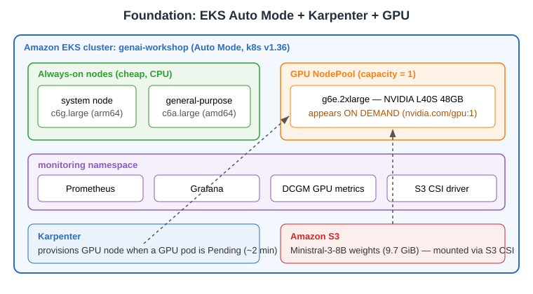

# Evidence: Foundation (EKS Auto Mode + Karpenter + GPU)

**Captured:** 2026-10-20 (live, read-only)
**Cluster:** `genai-workshop` | **Account:** `215808926717` | **Region:** `us-east-2`
**Identity:** `arn:aws:sts::215808926717:assumed-role/WSParticipantRole/Participant`

---

## 1. Cluster access

```
$ aws eks update-kubeconfig --name genai-workshop --region us-east-2
Added new context arn:aws:eks:us-east-2:215808926717:cluster/genai-workshop
```

## 2. Nodes (EKS Auto Mode, Bottlerocket)

```
$ kubectl get nodes -o wide
NAME                  STATUS   VERSION               INTERNAL-IP   OS-IMAGE
i-004957a4084a8d2a4   Ready    v1.36.2-eks-bca9cf6   10.0.37.142   Bottlerocket (EKS Auto, Standard) amd64
i-0b9eeeee3e89a79d6   Ready    v1.36.2-eks-bca9cf6   10.0.20.193   Bottlerocket (EKS Auto, Standard) arm64
i-07b0ae4709740cfea   Ready    v1.36.2-eks-bca9cf6   10.0.52.222   Bottlerocket (EKS Auto, Nvidia)   amd64   <- GPU node
```

## 3. Karpenter NodePools (the GPU cap)

```
$ kubectl get nodepools -o wide
NAME              NODECLASS   NODES   READY   CPU   MEMORY
general-purpose   default     1       True    2     3882612Ki
gpu               gpu         1       True    8     64946292Ki
system            default     1       True    2     3897492Ki
```

**Key fact:** the `gpu` NodePool is capped at **1 node**. Only one GPU workload runs at a time; the next GPU module requires deleting the current one first.

## 4. NodeClaims (actual EC2 instances)

```
$ kubectl get nodeclaims
NAME                    TYPE          CAPACITY    ZONE         READY
general-purpose-9flkx   c6a.large     on-demand   us-east-2b   True
gpu-hxrxx               g6e.2xlarge   reserved    us-east-2c   True   <- NVIDIA L40S
system-lx49c            c6g.large     on-demand   us-east-2a   True
```

## 5. GPU node allocatable (verified)

```
$ kubectl describe node i-07b0ae4709740cfea
node.kubernetes.io/instance-type=g6e.2xlarge
nvidia.com/gpu.present=true
Taints:             nvidia.com/gpu=true:NoSchedule
  nvidia.com/gpu:     1
```

## 6. Model weights in S3 (verified present)

```
$ aws s3 ls s3://genai-models-215808926717/Ministral-3-8B-Instruct-2512/ --human-readable
  19.8 KiB README.md
   2.3 KiB SYSTEM_PROMPT.txt
   1.9 KiB config.json
   9.7 GiB consolidated.safetensors      <- model weights
 131 Bytes generation_config.json
 100.8 KiB model.safetensors.index.json
   1.2 KiB params.json
 976 Bytes processor_config.json
  16.0 MiB tekken.json
  16.3 MiB tokenizer.json
  20.7 KiB tokenizer_config.json
```

## 7. Supporting infrastructure (verified running)

- `kube-system`: `metrics-server` (2), `s3-csi-controller` + `s3-csi-node` (Mountpoint for S3)
- `monitoring`: full `kube-prometheus-stack` (Prometheus, Grafana, operator, node/state exporters) + `grafana-operator`
- ALB: native EKS Auto Mode `ingressclass alb` (controller `eks.amazonaws.com/alb`)
- `model-storage-sa` (S3 access via Pod Identity) and `s3-access-sa` (RAG role) present in `default`

**Verdict:** Foundation ✅ — base nodes + monitoring + S3 CSI up; GPU provisioned on demand by Karpenter.


