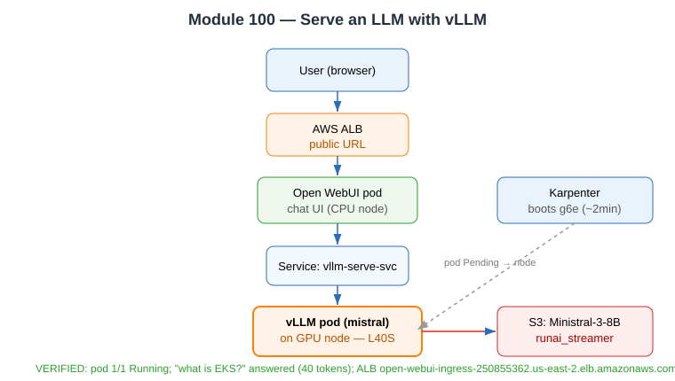

# Evidence: Module 100 — Serve an LLM with vLLM

**Status:** ✅ Fully verified end-to-end
**What it proves:** The Ministral model in S3 becomes a live OpenAI-compatible API + public chat UI, served by vLLM on a Karpenter-provisioned GPU node.

---

## Commands executed

```bash
kubectl apply -f .deploy/100-vllm-deployment.yml    # bucket substituted to genai-models-215808926717
kubectl apply -f .deploy/100-openwebui.yml           # m5.xlarge nodeSelector removed (EKS Auto Mode)
kubectl apply -f 100-vllm/vllm-servicemonitor.yaml
```

```
service/vllm-serve-svc created
deployment.apps/mistral created
deployment.apps/open-webui created
service/open-webui created
ingress.networking.k8s.io/open-webui-ingress created
servicemonitor.monitoring.coreos.com/mistral-monitor created
```

## GPU provisioning (Karpenter, real)

```
$ kubectl get nodeclaims
gpu-r2bfl   g6e.2xlarge   reserved   us-east-2c   i-0e21007a3c483b181   True   116s
```
Karpenter booted a `g6e.2xlarge` (NVIDIA L40S, 48 GB) in ~2 minutes after the GPU pod went Pending.

## Pod reached Running + model loaded

```
$ kubectl get pods -o wide
NAME                       READY   STATUS    AGE
mistral-5f64b8bc8f-hq5sv   1/1     Running   5m26s   (on GPU node i-0e21007a3c483b181)
open-webui-657f57fd8f...   1/1     Running   5m17s   (on general-purpose node)

vLLM log: "Application startup complete." + GET /v1/models 200 OK
```

## /v1/models (verified)

```json
$ curl http://localhost:8000/v1/models
{"object":"list","data":[{"id":"ministral","object":"model","owned_by":"vllm",
"root":"s3://genai-models-215808926717/Ministral-3-8B-Instruct-2512/","max_model_len":8192}]}
```

## Real inference (verified)

```json
$ curl -X POST .../v1/chat/completions -d
  '{"model":"ministral","messages":[{"role":"user","content":"In one sentence, what is Amazon EKS?"}],"max_tokens":60}'

{"choices":[{"message":{"role":"assistant","content":
  "**Amazon Elastic Kubernetes Service (EKS)** is a **managed Kubernetes service** provided by AWS
   that simplifies deploying, scaling, and operating containerized applications without needing to
   operate the underlying infrastructure."}, "finish_reason":"stop"}],
 "usage":{"prompt_tokens":13,"completion_tokens":40,"total_tokens":53},
 "system_fingerprint":"vllm-0.21.0-8f1bac7c"}
```

## Public endpoint (verified)

```
$ kubectl get ingress open-webui-ingress
NAME                 CLASS   ADDRESS                                                     PORTS
open-webui-ingress   alb     open-webui-ingress-250855362.us-east-2.elb.amazonaws.com   80
```

## Config highlights

- vLLM 0.21.0 (AWS DLC image, SOCI lazy-load), `--load-format=runai_streamer` (streams weights from S3)
- `--served-model-name=ministral`, `--max-model-len=8192`, `--enforce-eager`, FlashInfer backend
- Tool calling enabled: `--enable-auto-tool-choice --tool-call-parser=mistral` (used by Module 200)
- GPU node allocatable: `nvidia.com/gpu: 1`, device plugin auto-installed by EKS Auto Mode

**Verdict:** ✅ model served, real answer produced, public UI live.


