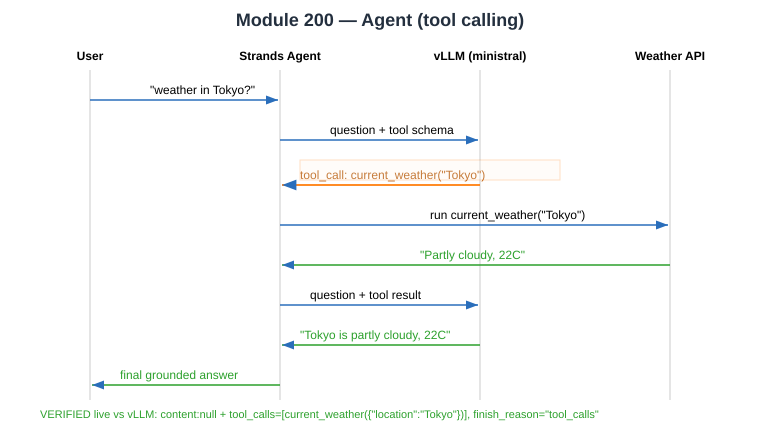

# Evidence: Module 200 — Agent (tool calling)

**Status:** ✅ Core (tool-calling) verified | ⚠️ Agent container not built (no Docker in environment)
**What it proves:** The model can emit a structured tool call instead of plain text — the mechanism the Strands agent orchestrates.

---

## Environment limitation (honest)

The agent app (`strands-agent.py`) ships as source + `Dockerfile` and must be built into a container and pushed to ECR (`image: $ECR_REPO:latest`). **Docker is not available in this execution environment**, so the FastAPI wrapper pod was not deployed. Module 200 also reuses Module 100's `vllm-serve-svc` (it has no separate vLLM deployment).

## Tool-calling core verified directly against live vLLM

Request (weather tool schema + Tokyo question):
```bash
curl -X POST .../v1/chat/completions -d '{
  "model":"ministral",
  "messages":[{"role":"user","content":"What is the current weather in Tokyo?"}],
  "tools":[{"type":"function","function":{"name":"current_weather",
    "description":"Get the current weather for a location",
    "parameters":{"type":"object","properties":{"location":{"type":"string"}},"required":["location"]}}}],
  "tool_choice":"auto"}'
```

Response (verified — model requests the tool, does not answer directly):
```json
{"choices":[{"message":{"role":"assistant","content":null,
  "tool_calls":[{"id":"ZzP8IuJIx","type":"function",
    "function":{"name":"current_weather","arguments":"{\"location\": \"Tokyo\"}"}}]},
  "finish_reason":"tool_calls"}],
 "usage":{"prompt_tokens":80,"completion_tokens":12,"total_tokens":92}}
```

**This is the exact agent mechanism:** `content: null` + `tool_calls` + `finish_reason: tool_calls`. In the full flow the agent runs `current_weather("Tokyo")`, feeds the result back, and the model composes the final grounded answer.

**Verdict:** ✅ tool-calling (the educational core) proven live; container build blocked by missing Docker (documented).


