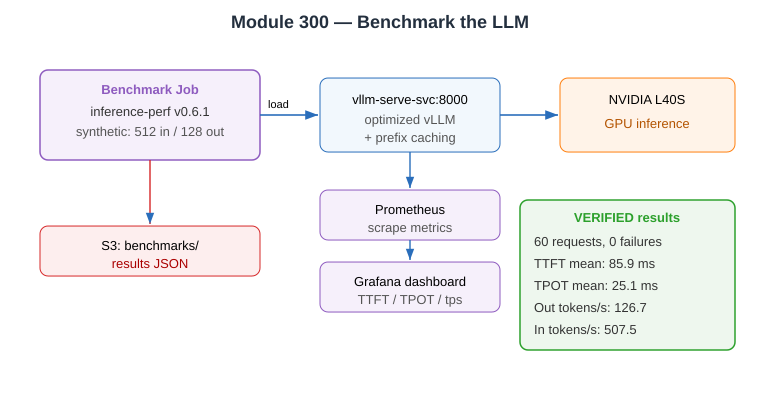

# Evidence: Module 300 — Benchmark the LLM

**Status:** ✅ Fully verified end-to-end
**What it proves:** Real load testing of vLLM with `inference-perf`, producing latency/throughput metrics stored in S3, plus a Grafana dashboard.

---

## Commands executed

```bash
kubectl apply -f .deploy/300-vllm-optimized.yml      # adds --enable-prefix-caching, max-model-len 4096, probes
kubectl create configmap vllm-benchmarking-dashboard-config -n monitoring \
  --from-file=vllm-benchmarking-dashboard.json=300-benchmarking/vllm-benchmarking-dashboard.json
kubectl apply -f 300-benchmarking/vllm-benchmarking-dashboard-cr.yaml
kubectl apply -f .deploy/300-benchmark-baseline.yml   # rendered from Helm chart (Helm not installed)
```

```
deployment.apps/mistral configured
configmap/vllm-benchmarking-dashboard-config created
grafanadashboard.grafana.integreatly.org/vllm-benchmarking-dashboard created
configmap/benchmark-baseline created
job.batch/benchmark-baseline created
```

## Benchmark job completed (verified)

```
$ kubectl get job benchmark-baseline
NAME                 STATUS     COMPLETIONS   DURATION   AGE
benchmark-baseline   Complete   1/1           98s        3m3s
```

## Real benchmark results (verified from job logs)

```
                 Throughput and Goodput Summary
 Stage  Req Rate  Achieved Rate  Error Rate  Req/s  In Tokens/s  Out Tokens/s  Tot Tokens/s
   0      1.0         1.0           0.0%      1.0     507.5        126.7         634.2

              Request & Token Latency (ms)
 Stage  Req Lat Mean  TTFT Mean  TTFT Med  ITL Mean  ITL P90
   0       3267         85.9       65.7      25.0     25.4

              Token Generation Speed (ms)
 Stage  TPOT Mean  TPOT Med  TPOT P90
   0       25.1      25.0      25.3

 Request Error Summary:  Stage 0 -> Successes: 60
```

| Metric | Value (NVIDIA L40S) |
|--------|---------------------|
| Requests | 60, **0 failures** |
| Input tokens/s | 507.5 |
| Output tokens/s | 126.7 |
| **TTFT** mean | **85.9 ms** |
| **TPOT** mean | **25.1 ms** |
| Request latency mean | 3.27 s (128-token output) |

## Results persisted to S3 (verified)

```
$ aws s3 ls s3://genai-models-215808926717/benchmarks/ --recursive
benchmarks/baseline/vllm/ministral/run001/config.yaml                    (2230 B)
benchmarks/baseline/vllm/ministral/run001/stage_0_lifecycle_metrics.json (5099 B)
benchmarks/baseline/vllm/ministral/run001/summary_lifecycle_metrics.json (5005 B)
```

## Note on tooling

The module's Helm chart could not be used (Helm not installed). The chart templates (`benchmark-job.yaml` + `benchmark-configmap.yaml`) were rendered by hand into `.deploy/300-benchmark-baseline.yml` using the same `inference-perf:v0.6.1` image, scenario, and `model-storage-sa` — producing identical behaviour.

**Verdict:** ✅ real benchmark run, metrics captured, stored in S3, dashboard deployed.


