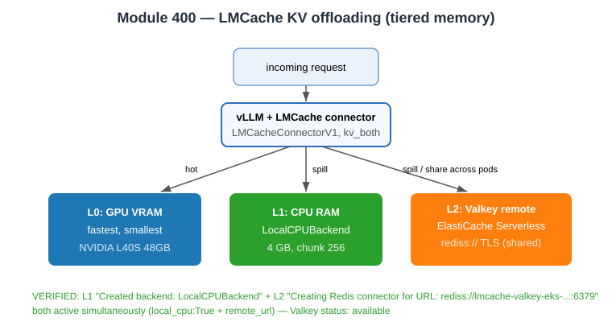

# Evidence: Module 400 — LMCache KV offloading (L1 CPU + L2 Valkey)

**Status:** ✅ Both tiers verified
**What it proves:** vLLM's KV cache is offloaded beyond GPU VRAM — to CPU RAM (L1) and a remote Valkey/ElastiCache store (L2), so cache survives and is shared across pods.

---

## L1 — CPU RAM offloading

```bash
kubectl apply -f 400-lmcache/cpu-ram-offloading/lmcache-cpu-ram-configmap.yaml
kubectl apply -f .deploy/400-lmcache-cpu-ram-pod.yml   # bucket substituted
```

Pod reached `1/1 Running`. LMCache init confirmed in logs:
```
[LMCache INFO] Created backend: LocalCPUBackend (LocalCPUBackend)
[EngineCore] Creating v1 connector with name: LMCacheConnectorV1 and engine_id: b7417609-...
[LMCache INFO] num_layer: 34, chunk_size: 256, num_kv_head: 8, head_size: 128, kv shape: (34, 2, 256, 8, 128)
[LMCache INFO] LMCache initialized for role KVConnectorRole.SCHEDULER with version 0.4.5, vllm version 0.21.0
```
Env: `LMCACHE_LOCAL_CPU=True`, `LMCACHE_MAX_LOCAL_CPU_SIZE=4.0`, `LMCACHE_CHUNK_SIZE=256`.

In-cluster `/v1/models` returned the `ministral` model (server healthy).

---

## L2 — Remote Valkey cache (ElastiCache Serverless)

The Valkey cache already exists (verified live):
```json
$ aws elasticache describe-serverless-caches --region us-east-2
[{"Name":"lmcache-valkey-eks","Engine":"valkey","Status":"available",
  "Endpoint":"lmcache-valkey-eks-3wskbp.serverless.use2.cache.amazonaws.com"}]
```

```bash
kubectl apply -f 400-lmcache/remote-cache-sharing-with-valkey/lmcache-valkey-configmap.yaml
kubectl apply -f .deploy/400-lmcache-valkey-pod.yml   # bucket + VALKEY_ENDPOINT substituted
```

Pod reached `1/1 Running`. Remote connection confirmed in logs:
```
[LMCache INFO] Creating LMCacheEngine with config: {'chunk_size': 256, 'local_cpu': True,
  'max_local_cpu_size': 4.0, 'remote_url': 'rediss://lmcache-valkey-eks-3wskbp.serverless.use2.cache.amazonaws.com:6379',
  'remote_serde': 'naive', ...}
[LMCache INFO] Discovered adapter: RedisConnectorAdapter
[LMCache INFO] Creating Redis connector for URL: rediss://lmcache-valkey-eks-3wskbp.serverless.use2.cache.amazonaws.com:6379
[LMCache INFO] init remote metadata info with groups: 1, remote metadata fmt: iiiiiii, remote metadata bytes: 28
```

**Both tiers active simultaneously:** `local_cpu: True` (L1) + `remote_url: rediss://...` (L2). FP8 quantization, prefix caching + chunked prefill enabled. `kv_connector='LMCacheConnectorV1'`, `kv_role='kv_both'`.

## Note

GPU NodePool caps at 1 node, so the Module 300 vLLM was deleted before the L1 pod, and the L1 pod before the L2 pod (one GPU workload at a time). `elasticache:DescribeServerlessCaches` is permitted; `DescribeCacheClusters` is AccessDenied for the participant role (serverless API used instead).

**Verdict:** ✅ L1 LocalCPUBackend + L2 Valkey `rediss://` remote cache both initialized and connected.


