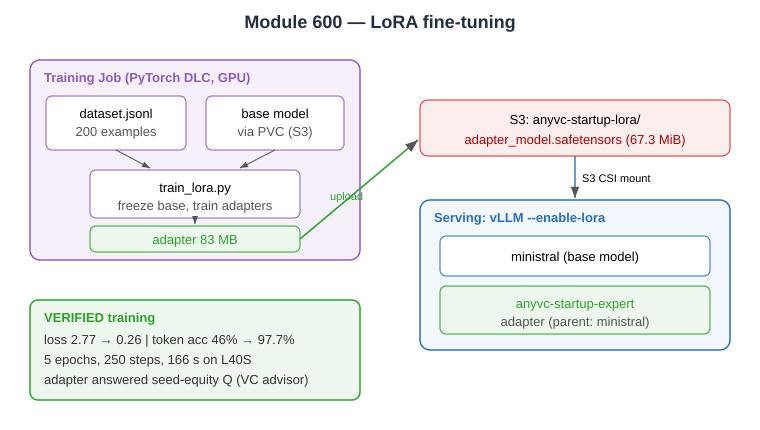

# Evidence: Module 600 — LoRA fine-tuning

**Status:** ✅ Fully verified end-to-end (train → upload → serve → inference)
**What it proves:** The base model is taught a new domain (VC startup advisor) by training a tiny LoRA adapter, which is then served alongside the base model by vLLM.

---

## 1. Training job launched

```bash
kubectl create configmap anyvc-training-scripts \
  --from-file=train_lora.py=600-finetuning/train_lora.py \
  --from-file=anyvc-startup-dataset.jsonl=600-finetuning/anyvc-startup-dataset.jsonl
kubectl apply -f .deploy/600-lora-training-job.yml    # S3 output bucket fixed to this account
```
Job scheduled onto the GPU node; mounts base model via `mistral-model-pvc` (S3-backed, ReadOnlyMany).

## 2. Training ran and the model learned (verified from logs)

```
[1/8] Validating model files...
[2/8] Loading dataset...   Loaded 200 training examples
[4/8] Loading model (FP8 -> BF16)...
[5/8] Attaching LoRA adapters...  (q_proj,k_proj,v_proj,o_proj)
[7/8] Training...
{'loss': 2.766, 'mean_token_accuracy': 0.4653, 'epoch': 0.02}   <- start
...
{'loss': 0.1378, 'mean_token_accuracy': 0.9769, 'epoch': 5.0}   <- end
{'train_runtime': 165.7, 'train_samples_per_second': 6.037, 'train_steps_per_second': 1.509,
 'train_loss': 0.2633, 'epoch': 5}

[8/8] Saving adapter...
  Loss: 0.2633 | Runtime: 166s | Size: 83.3 MB
  Uploaded to s3://genai-models-215808926717/anyvc-startup-lora/
Done! Serve with vLLM --enable-lora
```

| | Start | End |
|---|---|---|
| Loss | 2.77 | **0.26** |
| Token accuracy | 46.5% | **97.7%** |
| Epochs / steps | — | 5 / 250 |
| Runtime | — | 166 s |

## 3. Adapter persisted to S3 (verified live)

```
$ aws s3 ls s3://genai-models-215808926717/anyvc-startup-lora/ --human-readable
   1.5 KiB README.md
   1.0 KiB adapter_config.json
  67.3 MiB adapter_model.safetensors    <- the trained LoRA weights
  16.0 MiB tekken.json
```

## 4. Served base + adapter (verified)

```bash
kubectl apply -f .deploy/600-vllm-with-lora.yml   # creates s3-bucket-pv/pvc (S3 CSI mount) + --enable-lora
```
```json
$ curl http://vllm-serve-svc:8000/v1/models
{"data":[
  {"id":"ministral","root":"s3://genai-models-215808926717/Ministral-3-8B-Instruct-2512/"},
  {"id":"anyvc-startup-expert","root":"/s3/anyvc-startup-lora","parent":"ministral"}  <- the adapter
]}
```

## 5. Real inference from the fine-tuned adapter (verified)

Prompt: *"How much equity should a startup give to seed investors?"* (model `anyvc-startup-expert`)
```
"This question often comes up in venture capital discussions. The key factors are traction,
 market potential, and funding stage. ... If the market is $1B+ and growing, investors may
 accept 5-10% equity for early access. For niche markets, terms can be more..."
```
The adapter produces domain-specific VC/startup advisory responses — exactly its training objective.

**Verdict:** ✅ trained (loss 2.77→0.26) → uploaded to S3 → served with base → produced grounded domain answer.


