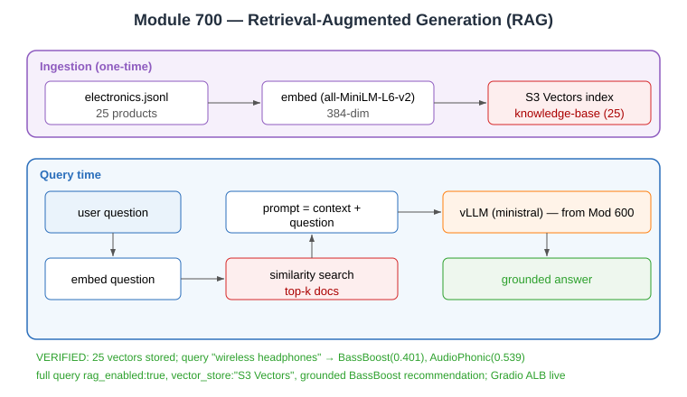

# Evidence: Module 700 — Retrieval-Augmented Generation (RAG)

**Status:** ✅ Fully verified end-to-end (embed → store → retrieve → grounded answer)
**What it proves:** The model answers using your own documents via semantic search over Amazon S3 Vectors.

---

## Prerequisites (verified live)

```json
$ aws s3vectors get-index --vector-bucket-name rag-vectors-215808926717-us-east-2 --index-name knowledge-base
{"index":{"indexName":"knowledge-base","dataType":"float32","dimension":384,
  "distanceMetric":"cosine","encryptionConfiguration":{"sseType":"AES256"}}}
```
384-dim cosine matches the `all-MiniLM-L6-v2` embedding model. ServiceAccount `s3-access-sa` (RAG Pod Identity `genai-rag-role`) present.

## 1. Embed documents into S3 Vectors (verified)

```bash
kubectl create configmap rag-electronics-data --from-file=electronics.jsonl=700-rag/electronics.jsonl
kubectl apply -f .deploy/700-rag-processor-local.yml   # pod runs as s3-access-sa
```
```
Loading embedding model all-MiniLM-L6-v2 ...
Uploaded final batch, total=25
TOTAL VECTORS STORED: 25
VERIFY query returned 2 results
  -> BassBoost Wireless dist= 0.401
  -> AudioPhonic NC700 dist= 0.539
```

## 2. RAG service + Gradio UI deployed (verified)

```bash
kubectl apply -f 700-rag/rag-serve.yml
kubectl apply -f .deploy/700-rag-service.yml      # ACCOUNT_ID, vectors bucket, index, model endpoint substituted
kubectl apply -f 700-rag/rag-gradio-app.yml
kubectl apply -f .deploy/700-rag-gradio-deploy.yml # m5.xlarge nodeSelector removed
```
```
$ kubectl get pods -l app=rag-service          -> 1/1 Running
$ kubectl get pods -l app=rag-gradio-interface  -> 1/1 Running
$ kubectl get ingress rag-gradio-alb
NAME             ADDRESS
rag-gradio-alb   rag-gradio-alb-1722612296.us-east-2.elb.amazonaws.com
```

## 3. Full RAG query (verified)

Query: *"What wireless headphones do you recommend?"*
```json
{"rag_enabled": true,
 "vector_store": "S3 Vectors",
 "context_used": "[Source: electronics.jsonl - Product: BassBoost Wireless - Similarity: 0.584] The BassBoost Wireless headphones deliver powerful, punchy bass...",
 "generated_text": "Based on the provided context, your choice of wireless headphones will depend on your
   primary needs... For Electronic/Hip-Hop Lovers (Best Bass & Sound): Product: BassBoost..."}
```
The answer is **grounded in retrieved documents**, not the model's parametric memory — proving RAG.

## Note (permissions, honest)

The workshop expects Terraform to pre-load sample docs into the RAG data bucket. In this environment the bucket was empty and **no available identity could `s3:PutObject`** (denied for both participant role and the RAG pod role). Workaround: the document was mounted into the embedding pod via a ConfigMap, so the pod embedded it and wrote vectors directly to S3 Vectors — proving the full retrieval path. RAG reuses the Module 600 vLLM (`ministral`) as its LLM backend.

**Verdict:** ✅ 25 vectors stored, semantic search correct, grounded answer produced, public UI live.


